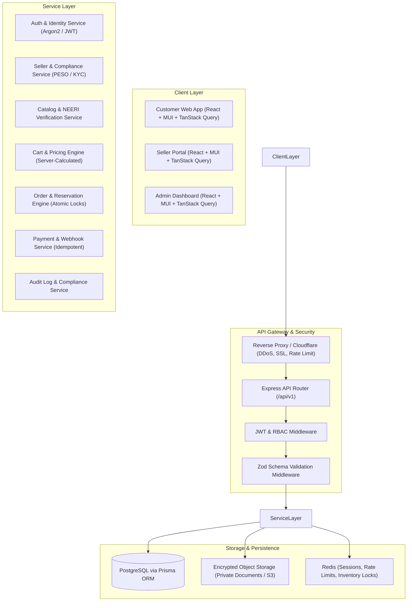
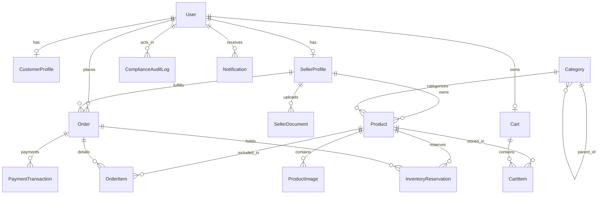
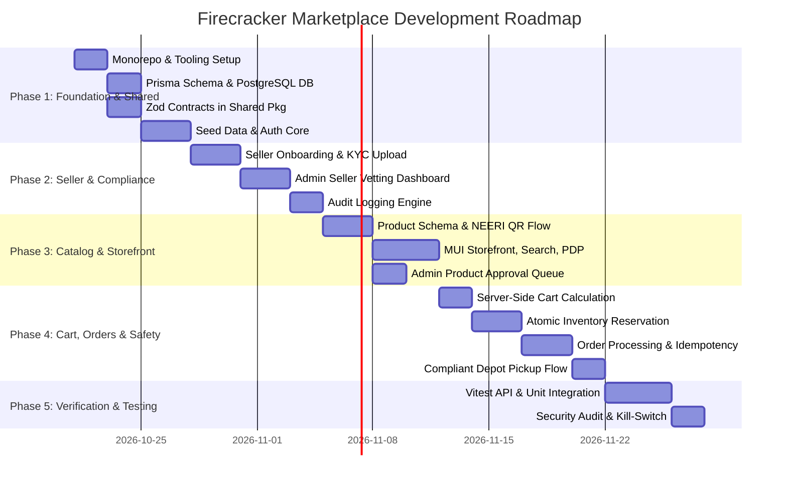

# Firecracker Marketplace — Architecture & Requirements Specification

## 1. Executive Summary & Problem Domain
The **Firecracker Marketplace** is a specialized, multi-vendor B2C/B2B e-commerce platform inspired by the intuitive browsing and checkout experiences of Amazon and Flipkart, tailored specifically to the legal, logistical, and safety requirements of fireworks sales in India.

### Regulatory Reality & Operating Model
1. **Legal Framework**: 
   - *The Explosives Act (1884)* & *The Explosives Rules (2008)*.
   - *PESO (Petroleum and Explosives Safety Organisation)* licensing for wholesale/retail storage (Forms LE-1, LE-3, LE-5).
   - *Supreme Court of India Directives*: Complete ban on toxic chemical formulations (Barium salts, Antimony, Lithium, Mercury, Arsenic, Lead, Chlorate) and mandate for **CSIR-NEERI certified Green Crackers** with scannable QR codes and sound level caps (<125 dB at 4m).
   - *Logistics & Transport Restriction*: Major postal and commercial couriers (BlueDart, Delhivery, India Post) strictly ban class 7 explosives in standard transport. 
2. **Safe Fulfilment Strategy**:
   - The platform operates on a **Compliant Click-and-Collect (Depot/Hub Pickup)** and **Authorized Direct-Transport** model (geo-fenced delivery handled only by PESO-licensed explosive transport vans holding Form LE-5 permits).
   - **Transaction Safety Kill-Switch**: The platform features a granular feature-flag (`FEATURE_ENABLE_LIVE_CHECKOUT=false` by default) to restrict initial deployment to catalog discovery, pre-booking, and licensed depot reservations until vendor licenses and logistics carriers are legally verified.

---

## 2. User Roles & Role-Based Access Control (RBAC)

| Role | Core Capabilities | Verification Gate |
| :--- | :--- | :--- |
| **Customer** | Browse catalog, search, filter green crackers, verify NEERI credentials, manage cart, place reservations/orders, track depot pickup, age-verify. | Self-declaration (18+) + phone OTP verification + physical ID proof at depot pickup. |
| **Seller** | Register shop, upload PESO license, explosive storage license, GSTIN, PAN, manage inventory, declare batch NEERI QR codes, handle depot handovers. | **Mandatory Admin Verification** of KYC and PESO storage license before any product listing or store activation. |
| **Administrator** | Approve/reject seller registrations, inspect and approve products & NEERI certificates, audit logs, dispute resolution, manage system feature flags and tax/pincode matrices. | Multi-factor authenticated administrative staff. |

---

## 3. High-Level System Architecture



---

## 4. Module Decomposition

### 4.1. Customer Storefront Module
- **Homepage**: Featured Diwali/celebration categories, certified Green Crackers banner, search bar with autocomplete, instant pincode eligibility check.
- **Catalog & Search**: Elastic/faceted filtering by Category (Sparklers, Flowerpots, Ground Chakkars, Sound Crackers, Aerial Shells, Gift Boxes), Decibel rating (<125 dB), Brand, Price, and CSIR-NEERI Green Cracker certification.
- **Product Details Page (PDP)**:
  - Technical specs, chemical composition declaration (Barium-free badge).
  - CSIR-NEERI Green Cracker QR verification preview.
  - Seller credentials badge (Verified PESO License Holder).
  - Depot pickup availability selector by Pincode/District.
- **Cart & Server-Side Pricing**:
  - Cart calculation strictly on the backend (prices, discounts, taxes, and handling fees computed per item).
  - Real-time stock validation against active reservations.
- **Customer Account**:
  - Order tracking with secure Pickup PIN / QR Code for depot verification.
  - Order history, invoice download, safety instruction leaflets.

### 4.2. Seller Onboarding & Management Module
- **Registration Workflow**:
  - Business name, Trade name, GSTIN, PAN.
  - PESO License details (Number, Form Type, Validity Period, Licensed Storage Capacity in KG).
  - Magazine / Godown physical location coordinates & Police NOC.
  - Upload scanned documents to secure private bucket.
- **Inventory & Catalog Management**:
  - Product creation with mandatory NEERI Green Cracker Certificate number and QR upload.
  - Sound level certification (<90 dB or 90–125 dB).
  - Batch number, date of manufacture, shelf-life/expiry.
  - Real-time inventory replenishment, safety threshold alerts.
- **Order Fulfilment**:
  - Depot handover verification (scanning customer pickup OTP/QR code).
  - Manifest generation for PESO-licensed carrier transport.

### 4.3. Admin & Compliance Governance Module
- **Seller Vetting Queue**: Two-stage approval workflow with document inspection (PESO portal verification, GST portal verification).
- **Product Approval Queue**: Mandatory review of chemical composition, NEERI QR validity, and packaging photos before listing goes public.
- **Compliance Audit Log**: Immutable record of every seller approval, product status toggle, inventory manual override, and price change.
- **Pincode & Legal Matrix**: Whitelist/blacklist delivery zones based on regional bans (e.g., Delhi NCR seasonal firecracker restrictions).
- **Master Kill-Switch**: Ability to halt checkouts globally or by state/district with a single click.

### 4.4. Order & Transaction Safety Module
- **Zero-Overselling Guarantee**:
  - 15-minute temporary reservation table backed by atomic database transactions (`SELECT ... FOR UPDATE` or Prisma `$transaction`).
  - Automatic expiration and rollback of reserved stock if payment is not confirmed within the window.
- **Duplicate Prevention & Idempotency**:
  - Client-generated or session-scoped `Idempotency-Key` header on all order creation and payment confirmation endpoints.
  - Webhook processing with replay protection and signature verification.

---

## 5. Database Schema & Relationships (Prisma ORM)



### Core Schema Definition (PostgreSQL / Prisma)

```prisma
datasource db {
  provider = "postgresql"
  url      = env("DATABASE_URL")
}

generator client {
  provider = "prisma-client-js"
}

enum Role {
  CUSTOMER
  SELLER
  ADMIN
}

enum SellerStatus {
  PENDING_SUBMISSION
  UNDER_REVIEW
  APPROVED
  REJECTED
  SUSPENDED
}

enum ProductStatus {
  DRAFT
  UNDER_REVIEW
  APPROVED
  REJECTED
  ARCHIVED
}

enum OrderStatus {
  RESERVATION_PENDING
  PAYMENT_PENDING
  CONFIRMED
  READY_FOR_PICKUP
  DISPATCHED_LICENSED_CARRIER
  COMPLETED
  CANCELLED
  EXPIRED
}

enum PaymentStatus {
  PENDING
  AUTHORIZED
  CAPTURED
  FAILED
  REFUNDED
}

enum FulfilmentType {
  LICENSED_DEPOT_PICKUP
  PESO_LICENSED_CARRIER
}

model User {
  id              String           @id @default(uuid())
  email           String           @unique
  phone           String           @unique
  passwordHash    String
  role            Role             @default(CUSTOMER)
  isEmailVerified Boolean          @default(false)
  isPhoneVerified Boolean          @default(false)
  isActive        Boolean          @default(true)
  createdAt       DateTime         @default(now())
  updatedAt       DateTime         @updatedAt

  customerProfile CustomerProfile?
  sellerProfile   SellerProfile?
  orders          Order[]
  auditLogs       ComplianceAuditLog[]
  notifications   Notification[]
  cart            Cart?
}

model CustomerProfile {
  id              String    @id @default(uuid())
  userId          String    @unique
  user            User      @relation(fields: [userId], references: [id], onDelete: Cascade)
  fullName        String
  isAgeVerified   Boolean   @default(false) // 18+ declaration
  dob             DateTime?
  idProofType     String?   // AADHAAR_MASKED, DRIVING_LICENSE, PASSPORT
  idProofNumber   String?
  addresses       Address[]
}

model SellerProfile {
  id                 String           @id @default(uuid())
  userId             String           @unique
  user               User             @relation(fields: [userId], references: [id], onDelete: Cascade)
  businessName       String
  tradeName          String
  gstin              String           @unique
  pan                String           @unique
  pesoLicenseNumber  String           @unique
  pesoLicenseExpiry  DateTime
  storageCapacityKg  Decimal          @db.Decimal(10, 2)
  magazineAddress    String
  policeNocNumber    String
  verificationStatus SellerStatus     @default(UNDER_REVIEW)
  verifiedAt         DateTime?
  verifiedBy         String?          // Admin User ID
  rejectionReason    String?
  products           Product[]
  documents          SellerDocument[]
  orders             Order[]
  createdAt          DateTime         @default(now())
  updatedAt          DateTime         @updatedAt
}

model SellerDocument {
  id             String        @id @default(uuid())
  sellerId       String
  seller         SellerProfile @relation(fields: [sellerId], references: [id], onDelete: Cascade)
  docType        String        // PESO_LICENSE, GST_CERT, POLICE_NOC, STORAGE_PLAN
  fileKey        String        // S3 object key (private bucket)
  mimeType       String
  fileSize       Int
  isVerified     Boolean       @default(false)
  createdAt      DateTime      @default(now())
}

model Category {
  id                String     @id @default(uuid())
  name              String
  slug              String     @unique
  description       String?
  parentId          String?
  parent            Category?  @relation("SubCategories", fields: [parentId], references: [id])
  children          Category[] @relation("SubCategories")
  minAgeRequired    Int        @default(18)
  isGreenOnly       Boolean    @default(true)
  products          Product[]
}

model Product {
  id                   String        @id @default(uuid())
  sellerId             String
  seller               SellerProfile @relation(fields: [sellerId], references: [id], onDelete: Restrict)
  categoryId           String
  category             Category      @relation(fields: [categoryId], references: [id], onDelete: Restrict)
  name                 String
  slug                 String        @unique
  description          String
  chemicalComposition String        // Barium-free statement & constituents
  decibelRating        Decimal       @db.Decimal(5, 2) // Must be <= 125.00 dB
  neeriQrCodeUrl       String        // Green Cracker NEERI verification QR code
  neeriCertNumber      String
  basePrice            Decimal       @db.Decimal(10, 2)
  salePrice            Decimal       @db.Decimal(10, 2)
  stockQuantity        Int           // Available physically
  reservedQuantity     Int           @default(0) // Locked in active checkout sessions
  minOrderQty          Int           @default(1)
  maxOrderQty          Int           @default(10) // Limit hoard purchase
  approvalStatus       ProductStatus @default(UNDER_REVIEW)
  rejectionReason      String?
  approvedBy           String?       // Admin User ID
  images               ProductImage[]
  orderItems           OrderItem[]
  cartItems            CartItem[]
  reservations         InventoryReservation[]
  createdAt            DateTime      @default(now())
  updatedAt            DateTime      @updatedAt

  @@index([approvalStatus, categoryId])
  @@index([sellerId])
}

model ProductImage {
  id        String   @id @default(uuid())
  productId String
  product   Product  @relation(fields: [productId], references: [id], onDelete: Cascade)
  url       String
  isPrimary Boolean  @default(false)
}

model Cart {
  id        String     @id @default(uuid())
  userId    String     @unique
  user      User       @relation(fields: [userId], references: [id], onDelete: Cascade)
  items     CartItem[]
  createdAt DateTime   @default(now())
  updatedAt DateTime   @updatedAt
}

model CartItem {
  id        String   @id @default(uuid())
  cartId    String
  cart      Cart     @relation(fields: [cartId], references: [id], onDelete: Cascade)
  productId String
  product   Product  @relation(fields: [productId], references: [id], onDelete: Cascade)
  quantity  Int
  createdAt DateTime @default(now())

  @@unique([cartId, productId])
}

model InventoryReservation {
  id        String      @id @default(uuid())
  orderId   String
  order     Order       @relation(fields: [orderId], references: [id], onDelete: Cascade)
  productId String
  product   Product     @relation(fields: [productId], references: [id], onDelete: Restrict)
  quantity  Int
  expiresAt DateTime
  isSettled Boolean     @default(false)
  createdAt DateTime    @default(now())

  @@index([expiresAt, isSettled])
}

model Order {
  id                  String                 @id @default(uuid())
  orderNumber         String                 @unique // Human readable: FCK-2026-XXXXX
  customerId          String
  customer            User                   @relation(fields: [customerId], references: [id], onDelete: Restrict)
  sellerId            String
  seller              SellerProfile          @relation(fields: [sellerId], references: [id], onDelete: Restrict)
  subtotalAmount      Decimal                @db.Decimal(10, 2)
  taxAmount           Decimal                @db.Decimal(10, 2)
  complianceFee       Decimal                @db.Decimal(10, 2)
  totalAmount         Decimal                @db.Decimal(10, 2)
  status              OrderStatus            @default(RESERVATION_PENDING)
  fulfilmentType      FulfilmentType         @default(LICENSED_DEPOT_PICKUP)
  pickupDepotName     String?
  pickupDepotAddress  String?
  pickupPinOtp        String?                // 6-digit secure OTP for physical collection
  idempotencyKey      String                 @unique
  items               OrderItem[]
  reservations        InventoryReservation[]
  payments            PaymentTransaction[]
  createdAt           DateTime               @default(now())
  updatedAt           DateTime               @updatedAt
}

model OrderItem {
  id          String   @id @default(uuid())
  orderId     String
  order       Order    @relation(fields: [orderId], references: [id], onDelete: Cascade)
  productId   String
  product     Product  @relation(fields: [productId], references: [id], onDelete: Restrict)
  unitPrice   Decimal  @db.Decimal(10, 2)
  quantity    Int
  totalAmount Decimal  @db.Decimal(10, 2)
}

model PaymentTransaction {
  id             String        @id @default(uuid())
  orderId        String
  order          Order         @relation(fields: [orderId], references: [id], onDelete: Cascade)
  gateway        String        // RAZORPAY, CASH_AT_DEPOT
  gatewayTxnId   String?       @unique
  amount         Decimal       @db.Decimal(10, 2)
  status         PaymentStatus @default(PENDING)
  signature      String?
  idempotencyKey String        @unique
  payload        Json?
  createdAt      DateTime      @default(now())
  updatedAt      DateTime      @updatedAt
}

model Address {
  id                String          @id @default(uuid())
  customerProfileId String
  customerProfile   CustomerProfile @relation(fields: [customerProfileId], references: [id], onDelete: Cascade)
  addressLine1      String
  addressLine2      String?
  city              String
  state             String
  pincode           String
  isPincodeRestricted Boolean       @default(false)
}

model ComplianceAuditLog {
  id         String   @id @default(uuid())
  actorId    String
  actor      User     @relation(fields: [actorId], references: [id], onDelete: Restrict)
  action     String   // VENDOR_APPROVAL, PRODUCT_VERIFICATION, KILL_SWITCH_TRIGGERED
  entityType String   // SELLER, PRODUCT, ORDER, SETTING
  entityId   String
  ipAddress  String?
  userAgent  String?
  details    Json
  createdAt  DateTime @default(now())

  @@index([entityType, entityId])
}

model Notification {
  id        String   @id @default(uuid())
  userId    String
  user      User     @relation(fields: [userId], references: [id], onDelete: Cascade)
  title     String
  message   String
  type      String   // INFO, WARNING, COMPLIANCE, ORDER
  isRead    Boolean  @default(false)
  createdAt DateTime @default(now())
}
```

---

## 6. API Conventions & Endpoints

### 6.1. Design Standard & Protocols
- **Format**: JSON over HTTP/2, RESTful resource routes.
- **Base URL Prefix**: `/api/v1`
- **Envelope Standard**:
  ```json
  {
    "success": true,
    "data": { ... },
    "error": null,
    "meta": {
      "timestamp": "2026-10-20T11:54:31.000Z",
      "requestId": "req_88f9a2..."
    }
  }
  ```
- **Error Response Standard (RFC 7807 compatible)**:
  ```json
  {
    "success": false,
    "data": null,
    "error": {
      "code": "INSUFFICIENT_UNRESERVED_STOCK",
      "message": "Only 3 items remain available for Flower Pots Special.",
      "details": [{ "field": "quantity", "available": 3, "requested": 5 }]
    },
    "meta": { ... }
  }
  ```

### 6.2. Route Matrix

| Category | Method & Path | Description | Access Control |
| :--- | :--- | :--- | :--- |
| **Auth** | `POST /api/v1/auth/register` | Register customer / seller candidate | Public |
| | `POST /api/v1/auth/login` | Login with credentials -> Set HTTP-only JWT cookie | Public |
| | `POST /api/v1/auth/refresh` | Refresh access token | Public (Cookie) |
| | `POST /api/v1/auth/logout` | Revoke session & clear cookies | Authenticated |
| **Catalog** | `GET /api/v1/categories` | Fetch category tree | Public |
| | `GET /api/v1/products` | Browse approved products (filters, search) | Public |
| | `GET /api/v1/products/:slug` | Product detail + NEERI QR + Seller credentials | Public |
| **Cart** | `GET /api/v1/cart` | View server-computed cart prices | Customer |
| | `POST /api/v1/cart/items` | Add/update item quantity with stock check | Customer |
| | `DELETE /api/v1/cart/items/:id` | Remove item from cart | Customer |
| **Orders** | `POST /api/v1/orders/checkout-reserve`| Create 15-min atomic reservation + Order | Customer (18+) |
| | `POST /api/v1/orders/:id/confirm-payment` | Idempotent payment verification | Customer |
| | `GET /api/v1/orders/:id` | Order details & secure collection OTP | Customer / Seller / Admin |
| **Seller** | `POST /api/v1/seller/onboard` | Submit KYC, PESO license, storage details | Authenticated Seller |
| | `POST /api/v1/seller/documents/presigned` | Request S3 upload URL for PESO docs | Authenticated Seller |
| | `GET /api/v1/seller/products` | List seller's products & approval status | Verified Seller |
| | `POST /api/v1/seller/products` | Create product with NEERI certificate | Verified Seller |
| | `PUT /api/v1/seller/products/:id/stock` | Update stock quantity | Verified Seller |
| **Admin** | `GET /api/v1/admin/sellers/pending` | List sellers awaiting KYC verification | Admin |
| | `PATCH /api/v1/admin/sellers/:id/verify` | Approve or reject seller with notes | Admin |
| | `GET /api/v1/admin/products/pending` | Review products & NEERI QR compliance | Admin |
| | `PATCH /api/v1/admin/products/:id/verify` | Approve or reject product | Admin |
| | `GET /api/v1/admin/audit-logs` | Immutable audit trail query | Admin |
| | `PATCH /api/v1/admin/system/flags` | Master switch for live transactions | Admin |

---

## 7. Folder Structure (Monorepo Blueprint)

We will use an `npm` or `pnpm` workspace setup keeping backend and frontend tightly coupled with a shared type library to avoid DTO synchronization bugs:

```
firecracker-marketplace/
├── package.json                   # Root monorepo workspace configuration
├── tsconfig.base.json             # Shared compiler options
├── .gitignore
├── .env.example                   # Master environment template
├── packages/
│   └── shared/                    # Shared contracts & DTOs
│       ├── package.json
│       ├── tsconfig.json
│       └── src/
│           ├── types/             # User, Role, Order, Product interfaces
│           ├── schemas/           # Zod validation schemas (Auth, Product, Order)
│           ├── constants/         # Regulatory limits, Decibel caps, Error codes
│           └── index.ts
├── apps/
│   ├── api/                       # Express Node.js Backend
│   │   ├── package.json
│   │   ├── tsconfig.json
│   │   ├── vitest.config.ts
│   │   ├── prisma/
│   │   │   ├── schema.prisma      # Prisma ORM schema
│   │   │   ├── migrations/        # Version-controlled migrations
│   │   │   └── seed.ts            # Development seed data (Categories, Admin, Demo Seller)
│   │   └── src/
│   │       ├── config/            # Env variables, Database client
│   │       ├── middleware/        # Auth, RBAC, Zod validation, Error handler
│   │       ├── modules/
│   │       │   ├── auth/          # Auth controllers, services, routes
│   │       │   ├── seller/        # KYC & onboarding module
│   │       │   ├── catalog/       # Products, Categories & NEERI validation
│   │       │   ├── cart/          # Server pricing & cart operations
│   │       │   ├── order/         # Order creation & atomic reservation lock
│   │       │   ├── payment/       # Payment gateway & idempotency handler
│   │       │   └── admin/         # Approvals, kill-switch, audit log
│   │       ├── utils/             # Logger, S3 presigned URLs, OTP generator
│   │       ├── app.ts             # Express application setup
│   │       └── server.ts          # Server entry point
│   └── web/                       # React + Vite Frontend
│       ├── package.json
│       ├── tsconfig.json
│       ├── vite.config.ts
│       ├── index.html
│       └── src/
│           ├── theme/             # Material UI (MUI) custom theme & typography
│           ├── api/               # Axios/Fetch client with interceptors
│           ├── hooks/             # TanStack Query custom hooks
│           ├── context/           # AuthContext, CartContext, NotificationContext
│           ├── components/        # Reusable UI (Navbar, ProductCard, Badge, Modal)
│           ├── pages/
│           │   ├── storefront/    # Home, Catalog, ProductDetail, Cart, Checkout
│           │   ├── seller/        # Onboarding, Dashboard, Products, Inventory
│           │   ├── admin/         # Verification Queues, Audit, Master Controls
│           │   └── auth/          # Login, Register, AgeGateModal
│           ├── App.tsx
│           └── main.tsx
```

---

## 8. Phased Implementation Roadmap



### Detailed Breakdown
- **Phase 1: Project Foundation & Security Backbone**
  - Monorepo orchestration (`package.json`, workspaces).
  - PostgreSQL database provision, Prisma schema migrations, and test seeders.
  - Authentication engine (JWT with Argon2, Refresh Token rotation in HTTP-only cookies).
  - Shared validation package (`@fck/shared`) with Zod schemas.
- **Phase 2: Seller Compliance, KYC & Admin Approvals**
  - Document upload pipeline with presigned private URLs.
  - Admin approval/rejection panel with granular reasons.
  - Immutable compliance audit log for all status changes.
- **Phase 3: Catalog, Green Cracker Verification & Customer Storefront**
  - Seller product upload with NEERI QR code parsing / certification details.
  - Public catalog with full-text search, sound rating filter, and Green Cracker Badges.
  - Admin product moderation queue.
- **Phase 4: Cart, Atomic Inventory Locking & Compliant Checkout**
  - Zero-trust cart calculation (prices never accepted from frontend).
  - Atomic 15-minute stock reservation with concurrency controls.
  - Depot / Pickup Hub allocation engine with collection PIN/OTP generation.
  - Idempotency key handling for duplicate-free checkout.
- **Phase 5: Automated Testing, Polishing & Risk Safeguards**
  - Vitest suite for API endpoints (auth, inventory locking, race-condition tests).
  - React Testing Library component tests.
  - End-to-end checkout simulation in compliance sandbox mode.

---

## 9. Security, Compliance & Deployment Risk Analysis

| Risk Category | Specific Threat / Vulnerability | Impact | Mitigation Strategy |
| :--- | :--- | :--- | :--- |
| **Legal & Regulatory** | Non-compliant courier delivery of Class 7 explosives (violation of Explosives Rules). | Heavy legal liability, platform shutdown, police seizure. | **Hard-block conventional delivery**: Implement strictly licensed Depot Click-and-Collect or fleet-verified local delivery vans. Keep `FEATURE_ENABLE_LIVE_CHECKOUT=false` until state-by-state legal checks pass. |
| **Counterfeit Products**| Fake Green Cracker logos or banned chemical formulations (Barium salts). | Environmental violation, Supreme Court contempt, safety hazards. | **Mandatory NEERI QR verification** during product moderation. Products cannot be published without admin manual review of the NEERI certificate. |
| **Underage Sales** | Sale of fireworks to minors (<18 years old). | Statutory violation of child protection laws. | Frontend age gate modal + backend validation + mandatory Government photo ID check at physical depot collection. |
| **Financial / Fraud** | Race conditions during Diwali flash sales leading to negative inventory (overselling). | Unfulfillable orders, customer outrage, depot chaos. | **Atomic database reservations** (`SELECT ... FOR UPDATE` inside Prisma transaction) with a 15-minute expiry countdown. |
| **Duplicate Charging** | Network timeouts leading to customers double-clicking "Pay". | Duplicate charges, reconciliation headaches. | **Idempotency Keys** required on checkout APIs. Keys are locked in Redis / DB for 60 seconds during processing. |
| **Data Protection** | Leaked seller PESO licenses, GST certificates, or customer PII. | Identity theft, regulatory non-compliance (DPDP Act). | Storage in **private encrypted buckets**; files served exclusively via temporary presigned URLs (TTL: 300s). Role-based authorization checked on each URL request. |
| **DDoS & Traffic Surges**| Extreme traffic spikes during seasonal festivals (Dussehra/Diwali). | Server downtime, degraded checkout experience. | Edge caching for public catalog (Cloudflare/CDN), connection pooling with PgBouncer, and rate-limiting on authentication and order creation endpoints. |

---

## 10. Verification & Implementation Status Checklist
- [x] High-level architectural diagram created
- [x] Database schema designed with all regulatory entities and safety constraints
- [x] Zero-trust security guidelines codified (server-authoritative cart and roles)
- [x] Indian fireworks compliance requirements embedded in data and workflows
- [x] Phased implementation plan scoped
- [x] **Phase 1: Foundation & Security Backbone (Completed)**
  - [x] Monorepo workspace configuration (`packages/*`, `apps/*`)
  - [x] `@fireworks/shared` package with Zod validation contracts, constants, & types
  - [x] PostgreSQL Prisma schema & Prisma Client generation
  - [x] Database seed script (`apps/api/prisma/seed.ts`)
  - [x] Express API engine (`app.ts`, `server.ts`)
  - [x] Authentication & RBAC modules (`/register`, `/login`, `/refresh`, `/logout`, `/me`)
  - [x] Vitest test suite passing (health check, validation, JWT guards)
- [ ] **Ready for Phase 2: Seller Compliance, KYC & Admin Approvals**
